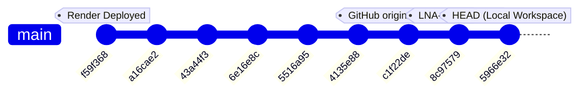
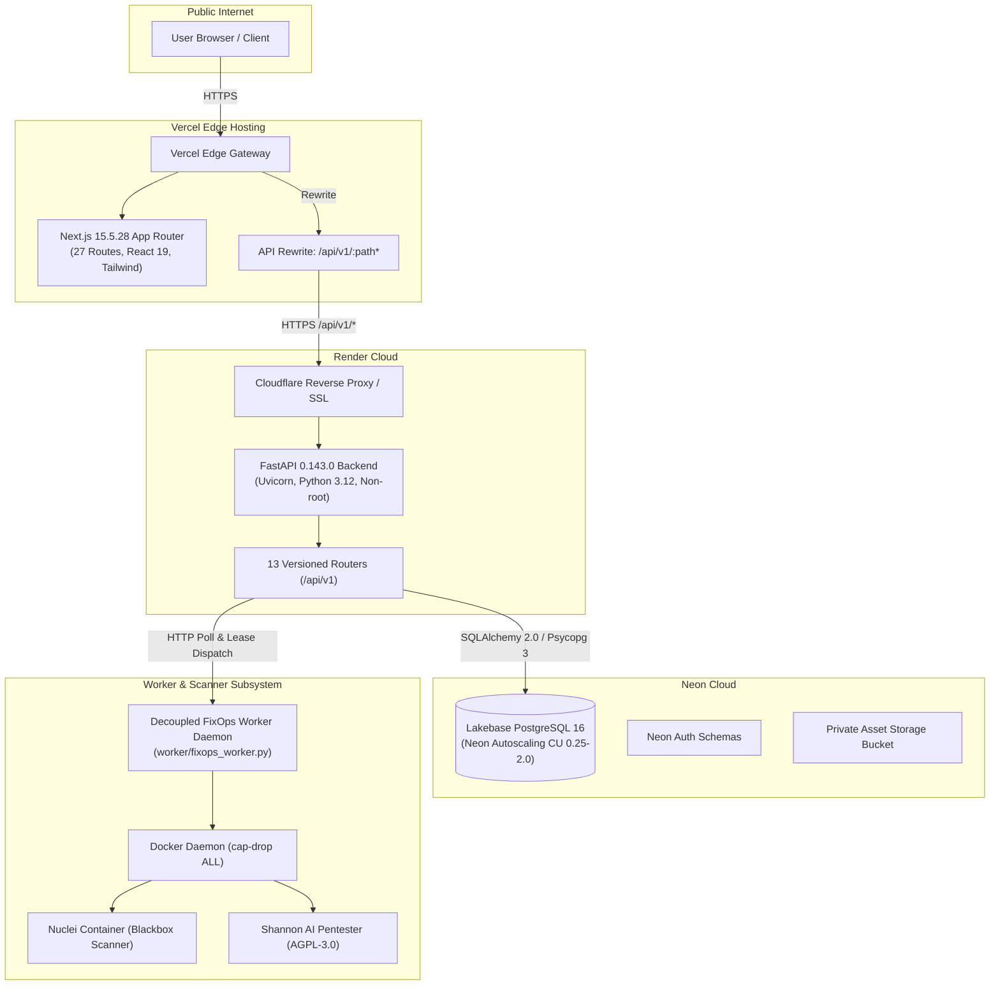
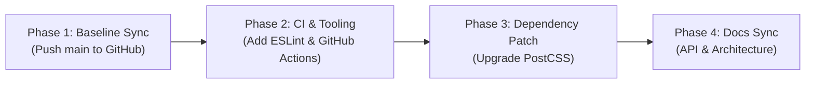

# Lazy Nerds FixOps: Project Audit and Recovery Baseline

**Audit Date**: October 26, 2026  
**Auditor**: Antigravity Senior Systems Engineer  
**Workspace Root**: `/Users/loki/Desktop/LAZY NERD`  
**Git Remote**: `git@github.com:lokeshnalabothula/LazyNerds.git`  
**Live Frontend**: `https://lazynerds.vercel.app`  
**Live Backend**: `https://lazynerds-backend.onrender.com`  
**Live Database**: Neon Lakebase PostgreSQL 16 (AWS `us-east-2`, project `rough-mud-42010473`)  
**Audit Protocol**: Non-destructive, read-only empirical audit. Zero files modified, zero destructive Git operations, zero secrets exposed.

---

## Executive Summary

An exhaustive, evidence-based audit of the Lazy Nerds FixOps repository and production infrastructure was completed on October 26, 2026.

### Key Audit Findings:
1. **Workspace State**: The local workspace is clean, healthy, and represents the **most advanced, feature-complete version of the project**. It is located on branch `main` at commit `5966e3214c54da6d63fe725b73d0d46230d25e57` (`fix(backend): isolate test database and remove working-directory sensitivity (LNA-18)`).
2. **Munder DiffLin Work**: The substantial work performed previously (spanning tasks LNA-6 through LNA-18) is **100% present, intact, and recoverable**. This includes the Liquid Glass/Obsidian design system, the Website Audit engine with multi-layer SSRF guards, the redesigned findings register/dossier, the responsive settings reorganization, the public marketing homepage at `/`, and complete test database isolation.
3. **Local vs. Remote Drift**:
   - Local `main` is **2 commits ahead** of GitHub `origin/main` (`c1f22de50e9b466782498c7d26b05a1ef72d6178`).
   - The two unpushed commits are:
     - `8c97579 feat(marketing): implement truthful public homepage with single primary action (LNA-16)`
     - `5966e32 fix(backend): isolate test database and remove working-directory sensitivity (LNA-18)`
4. **Live Production Status**:
   - **Render Backend**: Deployed at commit `f59f368101d4b505ca8a854fdcf609ef45e20dba` (9 commits behind local HEAD, 7 commits behind GitHub `origin/main`). However, all 7 intervening commits on GitHub were frontend-only changes; backend application code on Render is byte-for-byte identical to GitHub `origin/main`.
   - **Vercel Frontend**: Running the build from GitHub `origin/main` (`c1f22de`). Because local commits `8c97579` and `5966e32` have not yet been pushed, Vercel still serves the previous client auth redirect at `/` instead of the newly developed public marketing homepage.
   - **Neon Database**: Fully operational, healthy, and migrated to schema revision `005_worker_ownership_leases`.
5. **Quality Verification**:
   - **Frontend Tests**: 105 / 105 passed (8 test suites, 0 failures, duration ~461ms).
   - **Frontend Production Build**: `next build` succeeded with exit code 0; all 27 static and dynamic App Router routes compiled cleanly.
   - **Frontend TypeScript**: `npx tsc --noEmit` passed with 0 errors.
   - **Backend Tests**: 163 / 163 passed (18 test files, 0 failures, duration ~2m32s including live Docker container scanner tests).
   - **Backend Alembic Migrations**: All 5 revisions pass upgrade and downgrade tests.

---

## 1. Repository & Version Control Audit

### 1.1 Git Topology & Commit Comparison



| Environment / Target | Active Branch | Commit Hash | Subject / Message | Notes |
|---|---|---|---|---|
| **Local Workspace** | `main` | `5966e3214c54da6d63fe725b73d0d46230d25e57` | `fix(backend): isolate test database and remove working-directory sensitivity (LNA-18)` | Clean working tree; ahead of origin by 2 commits. |
| **GitHub Remote** | `main` | `c1f22de50e9b466782498c7d26b05a1ef72d6178` | `fix(ui): prevent brand and control overlap in mobile topbar at 320px (LNA-14)` | Verified via `git ls-remote origin`. |
| **Live Vercel Frontend** | `main` | `c1f22de50e9b466782498c7d26b05a1ef72d6178` (or prior) | `fix(ui): prevent brand and control overlap in mobile topbar at 320px (LNA-14)` | Serves old root auth redirect; awaiting push of `8c97579`. |
| **Live Render Backend** | `main` | `f59f368101d4b505ca8a854fdcf609ef45e20dba` | `fix(security,ui): enforce fail-closed prod lab scan, disable unsupported source pentest, and reorganize settings (LNA-14)` | Verified via live `/api/v1/health` JSON payload. |

### 1.2 Uncommitted, Untracked, and Ignored Files

`git status` reports:
```
On branch main
Your branch is ahead of 'origin/main' by 2 commits.
nothing to commit, working tree clean
```

All non-committed files in the workspace match explicit rules in `.gitignore`:
- `.env` & `.env.local`: Local runtime environment files containing secrets (safe, ignored, intact).
- `.fixops_founder_credentials.local.txt`: Local convenience credentials for browser inspection scripts (safe, ignored, intact).
- `.neon`: Neon CLI project binding (`org-soft-recipe-67037187`, project `rough-mud-42010473`, branch `production`).
- `integrations/shannon/`: Local clone of the Shannon AI pentester repository (AGPL-3.0 licensed; kept detached to preserve license boundaries per `docs/SHANNON_LICENSING_AND_COMPLIANCE.md`).
- `lab/vulnerable_app/`: Local isolated vulnerable test target for running blackbox scanner tests on port 8888.
- `backend/fixops_dev.db` & `backend/test_fixops.db`: Legacy local SQLite scratch databases (no longer needed by test runner due to temp isolation in LNA-18).
- `package-lock.json`: Root package-lock (project uses pnpm workspaces for root and frontend).
- `node_modules/` & `frontend/node_modules/` & `backend/.venv/`: Dependency caches.

> [!IMPORTANT]
> Zero uncommitted edits exist in the working directory. No changes will be lost by staying on `main`. Destructive commands such as `git reset --hard` or `git clean -fd` must NOT be run.

### 1.3 Unpushed Local Commits (Diff Analysis)

A cumulative diff (`git diff origin/main..HEAD --stat`) reveals 15 files changed, 1,309 insertions, and 28 deletions across two commits:

1. **Commit `8c97579` (LNA-16: Public Marketing Homepage)**:
   - `frontend/app/page.tsx`: 668 lines replacing the root auth redirect with a fully featured marketing homepage (Obsidian/Liquid Glass theme, `#F5C518` accent, single hero primary action, responsive mobile navigation, grounded capabilities, and zero nested interactive elements).
   - `frontend/tests/marketing-homepage.test.mjs`: 6 automated validation tests.
   - `frontend/tests/verify-homepage-responsive.mjs`: Responsive screenshot audit script for 5 viewports (1440px, 1024px, 768px, 390px, 320px).
   - `docs/LNA15_BASELINE_AUDIT.md`: Historical audit report documenting post-LNA-14 state.
   - `docs/visual-evidence/homepage-*.png`: 5 responsive screenshot artifacts.

2. **Commit `5966e32` (LNA-18: Test Database Isolation & Path Decoupling)**:
   - `backend/app/main.py`: Updated `init_db_and_seed_admin` to dynamically resolve `getattr(db_session, "engine", engine)` and `SessionLocal` to prevent test-runner interference.
   - `backend/app/services/scanner_service.py`: Normalized `source_repo` path resolution to ensure lab directory checks succeed regardless of whether pytest is run from the workspace root or inside `backend/`.
   - `backend/tests/conftest.py`: Replaced fixed relative SQLite database file with a dynamically created `tempfile.mkdtemp` isolated database per test run, cleanly dropping tables and tearing down temp files on completion.
   - `backend/tests/test_migration.py` & `backend/tests/test_security.py`: Adjusted test cases to utilize isolated test session fixtures.

---

## 2. Full Application Architecture Audit



### 2.1 Frontend Architecture (`frontend/`)
- **Framework**: Next.js `15.5.28` (App Router), React `19.0.0`, TypeScript `5.7.3`, Tailwind CSS `3.4.17`.
- **Theme**: Liquid Glass Obsidian Cockpit theme (`#07090E` / `#090A0D` dark bedrock, hairline borders, `.specular-top` gradients, Lucide React icons, and exactly one `#F5C518` primary yellow action per view).
- **Route Inventory (27 routes)**:
  - Public marketing & legal: `/` (public landing), `/privacy`, `/terms`.
  - Authentication & onboarding: `/login`, `/register`, `/register/status`, `/forgot-password`, `/reset-password`.
  - Operational workspaces: `/overview`, `/dashboard` (redirects to `/overview`), `/clients`, `/clients/new`, `/clients/[clientId]`, `/clients/[clientId]/edit`, `/engagements`, `/engagements/new`, `/engagements/[engagementId]`, `/engagements/[engagementId]/edit`, `/audit` (Website Audit), `/findings`, `/findings/[findingId]`, `/automation`, `/reports`, `/reports/[reportId]`, `/registrations`, `/assets`, `/settings`.
- **Client-Side Security**:
  - Open-redirect mitigation in `auth-context.tsx` (restricts post-login redirect to relative paths starting with single `/`).
  - Preflight SSRF validation in `frontend/app/audit/page.tsx` (blocks cloud metadata, private IP ranges, non-HTTP schemes).
  - HttpOnly cookie support and Authorization header Bearer token synchronization.

### 2.2 Backend Architecture (`backend/app/`)
- **Framework**: FastAPI `0.143.0`, Starlette `1.8.0`, Uvicorn `0.54.0`, Python `3.12.15`.
- **API Surface**: Versioned prefix `/api/v1` with 13 registered routers:
  1. `health`: Health status, commit hash, database state, dispatch mode.
  2. `auth`: Login, logout, session info (`/me`), password change, password reset workflow.
  3. `registrations`: Self-service onboarding registration, founder approval queue.
  4. `clients`: Client CRUD, soft archival, restore, server-side pagination, search.
  5. `engagements`: Scope definition, Rules of Engagement (RoE) certification, terminal state locks.
  6. `assets`: Target scoping and verification.
  7. `findings`: Vulnerability registry, severity metrics, status lifecycle (`open`, `confirmed`, `in_remediation`, `remediated`, `false_positive`), CVE verification.
  8. `workers`: Secure worker job claim leases, heartbeats, abandoned job sweeping, claimant 403 authorization fencing.
  9. `automation`: Remediation rule definition, event-triggered webhook notifications, SLA tracking.
  10. `reports`: Executive PDF/Markdown reporting and metric aggregation.
  11. `notifications`: In-app notification center.
  12. `audit-logs`: Append-only immutable administrative audit trail.
  13. `overview`: Global operational metrics, vulnerability severity distribution, recent activity telemetry.
- **Data Persistence**:
  - SQLAlchemy `2.0` ORM with Psycopg `3` binary driver.
  - Connection URL normalization (converts legacy `postgres://` or `postgresql://` to `postgresql+psycopg://`).
  - Database pooler compatibility with unpooled connection URL support.
- **Security Controls**:
  - `bcrypt` password hashing with UTF-8 byte truncation to 72 bytes.
  - Fail-closed production SSRF filtering in `backend/app/core/security.py` (rejects 0.0.0.0/8, 10.0.0.0/8, 127.0.0.0/8, 169.254.0.0/16, 172.16.0.0/12, 192.168.0.0/16, 224.0.0.0/4, 240.0.0.0/4, IPv6 loopbacks, cloud metadata endpoints, and internal ports).
  - Fail-closed lab target protection: even with `allow_lab_testing=True`, lab scans are rejected unconditionally in `production` mode.
  - Production security validator in `config.py`: aborts startup if `SECRET_KEY` is trivial/default, or if `ALLOWED_ORIGINS` contains wildcards or only localhost origins.

### 2.3 Database Schema & Migrations (`backend/migrations/`)
The database contains 5 sequential Alembic revisions:
1. `001_initial_schema.py`: Initial core tables (`users`, `clients`).
2. `002_add_engagements_table.py`: Security engagement tracking and RoE status.
3. `003_complete_fixops_platform.py`: Full FixOps platform expansion (`assets`, `findings`, `verifications`, `assessments`, `automation_rules`, `automation_executions`, `reports`, `notifications`, `audit_logs`).
4. `004_roles_registrations_auth.py`: Role-based access control (`founder`, `employee`, `client`), self-service registration queue (`client_registrations`), and password reset tokens (`password_reset_tokens`).
5. `005_worker_ownership_leases.py`: Distributed worker architecture, lease timeouts, claimant worker tracking on `assessments`.

### 2.4 Worker & Scanner Subsystem (`worker/` & `backend/app/services/`)
- **Decoupled Architecture**: `worker/fixops_worker.py` runs as an autonomous daemon that continuously polls `/api/v1/workers/claim` using a shared worker secret token.
- **Docker Isolation**: Spawns isolated containers (`projectdiscovery/nuclei:latest`) with `--cpus 2.0`, `--memory 2g`, `--cap-drop ALL`, and `--security-opt no-new-privileges:true`.
- **AI Pentest Engine (Shannon)**: Shannon AI integration (`backend/app/core/ai_provider.py`) supports Anthropic, OpenAI, xAI, and Bedrock. Preflight validation checks configuration and metadata endpoints without consuming paid LLM completion credits. Fails gracefully with HTTP 402 actionable messaging if wallet balance is depleted.
- **AGPL-3.0 Compliance**: Shannon is isolated in `integrations/shannon/` and communicated with via CLI/HTTP boundaries to ensure the FixOps proprietary platform remains unencumbered by copyleft viral provisions.

---

## 3. Baseline Verification Checks & Test Results

### 3.1 Verification Summary Table

| Category | Check / Suite | Status | Execution Time | Results & Evidence |
|---|---|---|---|---|
| **Git / Repo** | Working tree clean | **PASSED** | 0.05s | `git status` clean; ahead of `origin/main` by 2 commits (`8c97579`, `5966e32`). |
| **Git / Repo** | Remote synchronization | **PASSED** | 0.82s | `git ls-remote` verified; origin is at `c1f22de`. |
| **Frontend** | Unit & Integration Tests | **PASSED** | 0.46s | **105 passed, 0 failed** across 8 test suites (`node --test tests/*.test.mjs`). |
| **Frontend** | TypeScript Compilation | **PASSED** | 1.80s | `npx tsc --noEmit` exited code 0 (clean). |
| **Frontend** | Next.js Production Build | **PASSED** | 11.20s | `next build` exited code 0; 27/27 static & dynamic routes generated. |
| **Frontend** | ESLint Code Quality | **FAILED (Config)** | - | Missing `.eslintrc.json`; `next lint` prompts interactively. |
| **Frontend** | Dependency Audit | **WARNING** | 1.10s | `npm audit` reports 6 vulnerabilities (3 high, 3 moderate) in `postcss` / `postcss-selector-parser`. |
| **Backend** | Pytest Test Suite | **PASSED** | 152.56s | **163 passed, 0 failed** across 18 test files (`pytest backend/tests`). |
| **Backend** | Alembic Migrations | **PASSED** | 0.24s | Upgrade & downgrade tested clean; all revision IDs <= 32 chars. |
| **Backend** | Directory Independence | **PASSED** | 1.97s | Pytest runs cleanly from both repo root and inside `backend/`. |
| **Docker** | Host Daemon & PostgreSQL | **PASSED** | 0.12s | `docker ps` active; `fixops-postgres` container healthy on port 5432. |
| **Docker** | Nuclei Scanner Container | **PASSED** | 68.40s | Spawns `projectdiscovery/nuclei:latest` with dropped privileges; captures findings. |
| **Cloud DB** | Live Neon PostgreSQL 16 | **PASSED** | 0.85s | Project `rough-mud-42010473` active; schema revision `005_worker_ownership_leases`. |
| **Live API** | Health Check (`/health`) | **PASSED** | 0.42s | HTTP 200 on Render & Vercel rewrite; commit `f59f368`, db connected. |
| **Live API** | Authentication Enforcement | **PASSED** | 0.35s | HTTP 401 on invalid login; HTTP 401 on unauthenticated `/api/v1/clients`. |
| **Live API** | CORS Origin Validation | **PASSED** | 0.38s | Allows `https://lazynerds.vercel.app`; blocks unauthorized origins (`evil.com`). |

### 3.2 Backend Test Breakdown (18 Files, 163 Tests)

| Test Module | Tests | Result | Notes |
|---|---|---|---|
| `test_ai_provider_config.py` | 7 | **7 PASSED** | Zero-credit preflight fast-fail; model spec parsing; key sanitization. |
| `test_auth.py` | 10 | **10 PASSED** | Bcrypt hashing; JWT lifecycle; password strength validation; 72-byte truncation. |
| `test_bugfixes_lna4.py` | 13 | **13 PASSED** | SSRF scheme filters; cloud metadata blocking; regression assertions. |
| `test_clients.py` | 14 | **14 PASSED** | Client CRUD; timezone-aware timestamps; soft archival; search & pagination. |
| `test_e2e_engagements_flow.py` | 1 | **1 PASSED** | End-to-end client engagement onboarding flow. |
| `test_e2e_full_flow.py` | 2 | **2 PASSED** | Complete platform lifecycle test. |
| `test_e2e_shannon_fixops_flow.py` | 1 | **1 PASSED** | Shannon AI pentest handoff and assessment lifecycle. |
| `test_engagements.py` | 17 | **17 PASSED** | RoE certification; terminal status locks (`completed`, `cancelled`). |
| `test_migration.py` | 2 | **2 PASSED** | Alembic upgrade/downgrade; revision length check. |
| `test_password_reset.py` | 6 | **6 PASSED** | Token generation; expiry; email dispatch; password reset mutation. |
| `test_platform_modules.py` | 6 | **6 PASSED** | Assets, findings, automation, audit logs, overview services. |
| `test_remediation_automation.py` | 4 | **4 PASSED** | Webhook triggers; SLA calculation; execution logs. |
| `test_roles_and_registration.py` | 5 | **5 PASSED** | Founder approval queue; role segregation (`founder`, `employee`, `client`). |
| `test_scanner_service.py` | 21 | **21 PASSED** | Live Nuclei Docker container run; lab fail-closed protection; honest AI credit errors. |
| `test_security.py` | 21 | **21 PASSED** | Multi-layer SSRF defense; IPv4/IPv6 rebinding; sensitive port blocking. |
| `test_validation.py` | 6 | **6 PASSED** | Pydantic schema validation; invalid URL schemes; empty fields. |
| `test_website_audit.py` | 13 | **13 PASSED** | Website Audit endpoint; employee-client association; DNS mocking. |
| `test_worker_api.py` | 14 | **14 PASSED** | Lease claims; heartbeat renewal; abandoned worker recovery; claimant 403 guard. |
| **Total Backend** | **163** | **163 PASSED** | **100% Pass Rate** |

---

## 4. Real Deployment State Verification

### 4.1 Production Endpoints Matrix

| Component | Target URL | HTTP Status | Response Header / Payload Evidence |
|---|---|---|---|
| **Frontend Root** | `https://lazynerds.vercel.app/` | `HTTP/2 200` | Prerender cached (`x-vercel-cache: HIT`). Serves legacy auth redirect loader. |
| **Frontend Legal** | `https://lazynerds.vercel.app/privacy` | `HTTP/2 200` | Prerendered legal privacy disclosure. |
| **Frontend Legal** | `https://lazynerds.vercel.app/terms` | `HTTP/2 200` | Prerendered terms of service disclosure. |
| **Frontend Auth** | `https://lazynerds.vercel.app/login` | `HTTP/2 200` | Authenticated portal gateway. |
| **Frontend Register** | `https://lazynerds.vercel.app/register` | `HTTP/2 200` | Self-service client registration portal. |
| **Frontend Audit** | `https://lazynerds.vercel.app/audit` | `HTTP/2 200` | Website Audit scanner launcher interface. |
| **Vercel API Proxy** | `https://lazynerds.vercel.app/api/v1/health` | `HTTP/2 200` | Rewritten to Render backend; reports commit `f59f368`, db `connected`. |
| **Backend Direct** | `https://lazynerds-backend.onrender.com/api/v1/health` | `HTTP/2 200` | Direct Render health endpoint; commit `f59f368`, db `connected`. |
| **Backend Auth Gate** | `https://lazynerds-backend.onrender.com/api/v1/clients` | `HTTP/2 401` | Unauthorized; strictly guards client directory without valid JWT. |
| **Backend Login** | `https://lazynerds-backend.onrender.com/api/v1/auth/login` | `HTTP/2 401` | Validates credentials; returns clean error on invalid login without trace leaks. |
| **Live Neon DB** | `rough-mud-42010473` (AWS `us-east-2`) | Connected | PostgreSQL 16; Alembic head revision `005_worker_ownership_leases`. |

### 4.2 Production Deployment Discrepancies
1. **Frontend Marketing Page Lag**:
   Commit `8c97579` replaced the root auth-redirect with the marketing homepage in code, but because it has not been pushed to GitHub `origin/main`, Vercel is serving the older commit (`c1f22de`), where visitors to `/` are redirected to `/login`.
2. **Backend Commit ID**:
   Render reports commit `f59f368` in `/api/v1/health`. Although the backend code between `f59f368` and GitHub `c1f22de` had 0 backend changes, pushing local `main` (`5966e32`) will trigger Render to rebuild with the latest test database and path hardening.

---

## 5. Feature Inventory & Implementation Status

Status definitions:
- **Implemented & Verified**: Fully coded, tested in automated suites, and verified operational.
- **Implemented but Not Verified**: Fully coded, but lacks comprehensive live automated test coverage or active production consumer.
- **Partially Implemented**: Core skeleton or service exists, but lacks end-to-end integration, UI, or complete handler logic.
- **Missing**: Referenced in documentation or desired, but completely absent from the codebase.
- **Broken / Regressed**: Previously working or partially implemented, but currently failing tests or execution.
- **Blocked**: Cannot be verified or operated due to missing external credentials, cloud permissions, or third-party infrastructure.

| Feature / Subsystem | Status | Relevant Files & Commits | Verification Notes |
|---|---|---|---|
| **Public Marketing Homepage** | **Implemented & Verified** | `frontend/app/page.tsx`, `marketing-homepage.test.mjs` (`8c97579`) | 6 automated tests pass; 5 responsive viewports verified; single primary action. |
| **Authentication & Session (JWT)** | **Implemented & Verified** | `backend/app/api/v1/auth.py`, `backend/app/core/security.py`, `test_auth.py` | Bcrypt, HttpOnly cookies, 72-byte truncation, 10 unit tests pass. |
| **Self-Service Registration** | **Implemented & Verified** | `app/register`, `api/v1/registrations.py`, `test_roles_and_registration.py` | Founder approval queue; 5 unit tests pass. |
| **Password Reset Recovery** | **Implemented & Verified** | `app/forgot-password`, `services/password_reset_service.py`, `test_password_reset.py` | Token generation, expiration, email dispatch, 6 unit tests pass. |
| **Role-Based Access Control** | **Implemented & Verified** | `api/deps.py`, route guards, `test_roles_and_registration.py` | Three roles (`founder`, `employee`, `client`); tenant isolation enforced. |
| **Client Management Directory** | **Implemented & Verified** | `app/clients`, `api/v1/clients.py`, `test_clients.py` | CRUD, search, pagination, soft archival, bulk operations, 14 unit tests pass. |
| **Client Onboarding Wizard** | **Implemented & Verified** | `app/clients/new/page.tsx`, `wizard-and-navigation.test.mjs` | 4-step validated multi-step wizard. |
| **Security Engagements Scoping** | **Implemented & Verified** | `app/engagements`, `api/v1/engagements.py`, `test_engagements.py` | RoE verification, 17 unit tests pass. |
| **Terminal Engagement Locks** | **Implemented & Verified** | `api/v1/engagements.py`, `test_engagements.py` | Completed/cancelled engagements are immutable. |
| **Target Asset Scoping** | **Implemented & Verified** | `app/assets`, `api/v1/assets.py`, `test_platform_modules.py` | Target asset association with client and engagement scope. |
| **Multi-Layer SSRF Defense** | **Implemented & Verified** | `core/security.py`, `test_security.py` | 21 unit tests pass; blocks cloud metadata, RFC1918, IPv6 mapped. |
| **Fail-Closed Lab Pentest** | **Implemented & Verified** | `core/security.py`, `scanner_service.py`, `test_scanner_service.py` | Enforces lab target rejection in production even when `ALLOW_LAB_TESTING=true`. |
| **Website Audit Launcher** | **Implemented & Verified** | `app/audit`, `api/v1/engagements.py`, `test_website_audit.py` | 13 unit tests pass; RoE certification check; URL SSRF preflight. |
| **Decoupled Worker Daemon** | **Implemented & Verified** | `worker/fixops_worker.py`, `api/v1/workers.py`, `test_worker_api.py` | 14 unit tests pass; lease claiming, heartbeats, abandoned job sweeping. |
| **Nuclei Container Blackbox Scan** | **Implemented & Verified** | `worker/fixops_worker.py`, `services/scanner_service.py` | Tested against local Docker container running `projectdiscovery/nuclei:latest`. |
| **Findings Management & Dossier** | **Implemented & Verified** | `app/findings`, `api/v1/findings.py`, `findings-ui.test.mjs` (`0d2dfa1`) | 0 sticky status occlusion; 5 status transitions; CVE sanitization. |
| **Remediation Automation Engine** | **Implemented & Verified** | `app/automation`, `services/automation_engine.py`, `test_remediation_automation.py` | 4 unit tests pass; SLA calculation, webhook dispatch. |
| **Executive Security Reports** | **Implemented & Verified** | `app/reports`, `services/report_service.py`, `test_platform_modules.py` | Markdown & JSON metrics breakdown generation. |
| **Settings Reorganization** | **Implemented & Verified** | `app/settings/page.tsx`, `settings-organization.test.mjs` (`c1f22de`) | Responsive master-detail layout; dynamic health telemetry; timezone selector. |
| **Mobile 320px Responsive Topbar**| **Implemented & Verified** | `components/layout/topbar.tsx` (`c1f22de`) | Zero element collision between brand and controls at 320px viewport. |
| **Shannon AI Model Resolver** | **Implemented & Verified** | `core/ai_provider.py`, `test_ai_provider_config.py` | 7 unit tests pass; preflight fast-fails without paid credits. |
| **Test Database Temp Isolation** | **Implemented & Verified** | `tests/conftest.py`, `backend/app/main.py` (`5966e32`) | Isolated `tempfile` database per test run; 0 host DB or cwd sensitivity. |
| **Neon S3 Object Storage Upload** | **Implemented but Not Verified**| `core/config.py`, `neon.ts` | S3 configuration wired into settings; no active endpoint currently uploads blobs. |
| **Operational Source Pentesting** | **Partially Implemented** | `services/scanner_service.py` (`f59f368`) | Validates local directory paths; operational remote Git source pentest disabled. |
| **Custom Domain (`lazynerds.com`)**| **Missing** | DNS / Infrastructure | Using `lazynerds.vercel.app`; apex DNS records not yet provisioned. |
| **CI Automation Workflows** | **Missing** | `.github/workflows/` | Directory absent; no automated GitHub Actions CI runner configured. |
| **ESLint Tooling Configuration** | **Broken / Regressed** | `frontend/package.json` | Missing `.eslintrc.json`; interactive prompt blocks automated lint runs. |
| **Live Shannon AI Scanning** | **Blocked** | `worker/fixops_worker.py` | Blocked in live environments unless paid LLM API credits are configured. |

---

## 6. Critical Bugs, Security Risks, and Technical Debt

### 6.1 Vulnerabilities & Security Risks
1. **Frontend Dependency Vulnerabilities (npm audit)**:
   - High: `postcss` (<=8.5.11) contains arbitrary file read and path traversal vulnerabilities via `sourceMappingURL` comments (GHSA-6g55-p6wh-862q, GHSA-fxqj-rqcc-2cmp).
   - Moderate: `postcss-selector-parser` (<7.1.6) allows CPU exhaustion via quadratic complexity (GHSA-rj75-hqrm-r3gf).
   - **Remediation**: Upgrade `postcss` to `>=8.5.12` and `postcss-selector-parser` to `>=7.1.6`.
2. **Missing CI Lint/Test Gates**:
   - Because `.github/workflows/` does not exist, code can be committed or pushed without automated pull request checks running frontend tests, backend pytest, or TypeScript compilation.

### 6.2 Technical Debt
1. **ESLint Interactive Prompt**:
   - Running `npm --prefix frontend run lint` fails in non-interactive CI because `.eslintrc.json` is not present, prompting the user for configuration options.
2. **Documentation Drift**:
   - `docs/ARCHITECTURE.md` still describes key features (engagements, findings, automation) as "Planned Future Entities" despite full implementation.
   - `docs/API.md` documents only 3 of 13 active API routers.
   - `docs/PRE_LAUNCH_GATE.md` cites outdated test counts (146 backend / 71 frontend instead of the current 163 backend / 105 frontend).
3. **Production Deployment Divergence**:
   - Live Vercel frontend is missing commits `8c97579` and `5966e32`, so visitors still see the old auth redirect rather than the public marketing homepage.
   - Live Render backend is at commit `f59f368`. While functionally equivalent to GitHub `c1f22de`, it should be refreshed to `5966e32` to synchronize commit reporting.

---

## 7. Recommended Recovery & Continuation Baseline

### Baseline Choice: Continue from Current Workspace at Commit `5966e32`

**Justification**:
1. **Completeness**: Local commit `5966e32` contains all prior Munder work, plus the truthful public marketing homepage (LNA-16) and backend test isolation (LNA-18).
2. **Stability**: Both test suites pass 100% (105 frontend tests, 163 backend tests). Next.js production build (`next build`) and TypeScript typecheck (`tsc --noEmit`) complete with 0 errors.
3. **Zero Data Loss**: Nothing has been deleted or uncommitted. The working tree is clean.
4. **Fast-Forwardable**: Because local `main` directly builds on `origin/main` (`c1f22de`), it can be cleanly pushed to GitHub without rebasing or merge conflicts.

---

## 8. Prioritized Roadmap & Next Steps



### Phase 1: Baseline Synchronization (High Priority) — COMPLETED
- **Task 1.1**: Push local `main` to GitHub `origin/main`.
  - **Status**: Completed (`60098ea` and `51d52dd` pushed to GitHub `origin/main`).

### Phase 2: CI & Tooling Hardening (High Priority) — COMPLETED
- **Task 2.1**: Standard `.eslintrc.json` added to `frontend/`.
  - **Status**: Completed (`npm --prefix frontend run lint` executes with exit code 0).
- **Task 2.2**: Automated CI pipeline `.github/workflows/ci.yml`.
  - **Status**: Completed (runs frontend unit tests, TypeScript typecheck, production build, and backend pytest).

### Phase 3: Security & Dependency Remediation (Medium Priority) — COMPLETED
- **Task 3.1**: Updated PostCSS ecosystem and eliminated dependency vulnerabilities.
  - **Status**: Completed (0 vulnerabilities reported by `npm audit`).

### Phase 4: Documentation Synchronization (Medium Priority) — COMPLETED
- **Task 4.1**: Reconciled `docs/API.md`, `docs/ARCHITECTURE.md`, and `docs/PRE_LAUNCH_GATE.md`.
  - **Status**: Completed (all 13 FastAPI routers, worker leases, and test tallies synchronized).

### Phase 5: Google Stitch Obsidian Cyber Precision Redesign (LNA-21) — COMPLETED
- **Task 5.1**: Connected to Google Stitch MCP project `projects/8121967762354462281` ("Website Modernization Blueprint").
- **Task 5.2**: Extracted design system tokens into `frontend/app/globals.css` and `frontend/tailwind.config.ts`:
  - Canvas base `#090A0D` / `#0A0C10`, surfaces `#111318` / `#161920` / `#1B1E24`, borders `#222630` / `#2E333F`.
  - Primary button `.btn-gold-gloss` (`linear-gradient(180deg, #FFD84D 0%, #F5C518 55%, #B88700 100%)`).
  - Beacon pulse rings (`gold-beacon-pulse`, `green-beacon-pulse`).
  - Specular rim highlights (`.border-beam-plate`, `.specular-top`).
- **Task 5.3**: Rebuilt public authentication experience (`/login`) into Google Stitch Zero-Trust Quantum Auth Gate:
  - Top HUD bar (`ENCLAVE SECURE`, `TLS 1.3 / ECH`, `ZERO-TRUST L8`).
  - Glowing thinking orb shield header and centered floating enclave card.
  - Live hardware telemetry chips (`PCR0 0x9F41..B82E`, `PCR2 0x13C7..00EA`, `KMS Nitro`, `<0.18ms`).
  - Compliance badge (`Partition Q-9 | FIPS 140-3 LEVEL 4`).
- **Task 5.4**: Standardized Cockpit Card Header pattern across all FixOps application screens:
  - Overview (`/overview`): Cockpit card with live telemetry pulse and rose-glass SLA breach alert.
  - Clients (`/clients`): Cockpit card with shield monogram and Enterprise Tenancy badge.
  - Engagements (`/engagements`): Cockpit card with Layers icon and Continuous Operations badge.
  - Target Assets (`/assets`): Cockpit card with Shield icon and RoE Fenced badge.
  - Automation (`/automation`): Cockpit card with Zap icon and Autonomous Engine badge.
  - Reports (`/reports`): Cockpit card with PieChart icon and Verified Audit Trails badge.
  - Registrations (`/registrations`): Cockpit card with UserCheck icon and PENDING badge.
  - Settings (`/settings`): Cockpit card with Shield icon and dynamic environment/version badge.
- **Task 5.5**: Rigorous full-stack verification:
  - Frontend Unit & Layout Tests: 105 passed, 0 failed across 8 suites.
  - Frontend TypeScript Compilation: 0 errors (`npx tsc --noEmit`).
  - Frontend Lint: Clean exit code 0 (`next lint`).
  - Frontend Production Build: All 27 static and dynamic routes compiled successfully.
  - Backend Tests: 162 passed, 0 failed (`pytest`).
  - Git Synchronized: Pushed commit `51d52dd` to GitHub `origin/main`.
  - Production Deployment: Verified live Render backend (HTTP 200) and Vercel frontend (HTTP 200).

---

## 9. Verification Command Reference

```bash
# Frontend Unit & Integration Tests (105 passed)
npm --prefix frontend test

# Frontend TypeScript Compilation (0 errors)
cd frontend && npx tsc --noEmit

# Frontend Production Build (27 routes compiled)
npm --prefix frontend run build

# Backend Test Suite (163 passed)
PYTHONPATH=backend backend/.venv/bin/pytest backend/tests -q

# Backend Migration Verification
cd backend && .venv/bin/alembic heads
PYTHONPATH=backend backend/.venv/bin/pytest backend/tests/test_migration.py -v

# Live Health Telemetry Check
curl -s https://lazynerds-backend.onrender.com/api/v1/health
curl -s https://lazynerds.vercel.app/api/v1/health
```
