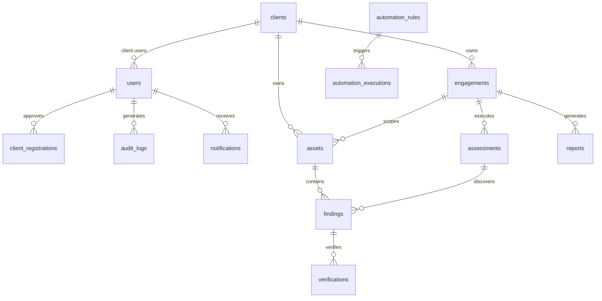

# LAZY NERDS FIXOPS PLATFORM — ARCHITECTURE SPECIFICATION

## 1. System Overview

**Lazy Nerds FixOps** is an integrated cybersecurity operations platform providing automated vulnerability scanning, continuous engagement management, client multi-tenant operations, automated remediation tracking, and verifiable reporting.

```
┌─────────────────────────────────────────────────────────────────────────┐
│                      Next.js 15 Frontend (App Router)                   │
│  - Public: /, /login, /register, /forgot-password, /privacy, /terms     │
│  - App:    /overview, /clients, /engagements, /assets, /findings,       │
│            /audit, /automation, /reports, /registrations, /settings     │
│  - Theme:  Liquid Glass Obsidian Cockpit with #F5C518 Primary Action    │
└────────────────────────────────────┬────────────────────────────────────┘
                                     │ HTTPS / JSON API (/api/v1)
                                     ▼
┌─────────────────────────────────────────────────────────────────────────┐
│                          FastAPI Backend Service                        │
│  - 13 Versioned API Routers          - Multi-Layer SSRF Guard           │
│  - Role-Based Access Control         - Lease-Based Worker Dispatcher    │
│  - Bcrypt / JWT / HttpOnly Cookie    - Structured Sanitized Logging     │
└──────────────────┬───────────────────────────────────┬──────────────────┘
                   │ SQLAlchemy 2.0 / Psycopg 3        │ HTTP Leased Jobs
                   ▼                                   ▼
┌──────────────────────────────────────┐  ┌───────────────────────────────┐
│        PostgreSQL 16 Database        │  │     Decoupled Worker Daemon   │
│  - users, client_registrations       │  │  - worker/fixops_worker.py    │
│  - clients, engagements, assets      │  │  - Isolated Docker Engine     │
│  - findings, verifications           │  │  - Nuclei Blackbox Container  │
│  - assessments, worker leases        │  │  - Shannon AI Pentester       │
│  - automation_rules, executions      │  │  - SSRF Destination Verifier  │
│  - reports, notifications, audit_logs│  └───────────────────────────────┘
│  - Alembic 005_worker_ownership_lease│
└──────────────────────────────────────┘
```

---

## 2. Technology Stack & Rationale

| Layer | Technology | Rationale |
|---|---|---|
| **Frontend Framework** | Next.js 15.5.28 (App Router), React 19 | Server-side rendering, hybrid static generation, fast edge routing. |
| **Language** | TypeScript 5.7.3 (Strict Mode) | End-to-end type safety with zero compiler errors. |
| **Styling** | Tailwind CSS 3.4.17 + Obsidian Theme | High-contrast `#07090E` bedrock, `.specular-top` hairline highlights, `#F5C518` yellow primary accents. |
| **Icons** | Lucide React | Uniform cybersecurity and operational iconography. |
| **Form Validation** | React Hook Form & Zod | Strict schema validation before network transmission. |
| **Backend Framework** | FastAPI 0.143.0 (Python 3.12.15) | Asynchronous execution, dependency injection, auto OpenAPI schema. |
| **Data Validation** | Pydantic v2 | Robust request/response serialization and injection prevention. |
| **ORM & Driver** | SQLAlchemy 2.0.35 & Psycopg 3.3.6 | Modern declarative ORM, pooled connections, parameterized queries. |
| **Database Migrations** | Alembic 1.20.0 | Deterministic, forward and rollback tested database schema versions. |
| **Database Engine** | PostgreSQL 16 (Neon Lakebase Cloud) | Autoscaling 0.25–2.0 CU compute with point-in-time recovery and branching. |
| **Scanner Engine** | ProjectDiscovery Nuclei & Shannon AI | Containerized blackbox scanning and autonomous AI vulnerability probing. |

---

## 3. Implemented Database Schema & Entity Relationships

The PostgreSQL database contains 14 operational tables managed across 5 Alembic revisions:



### 3.1 Primary Implemented Entities

1. **`users`**: Administrative personnel (`founder`, `employee`) and authorized client operators (`client`).
2. **`client_registrations`**: Self-service applicant queue awaiting founder review and automated account provisioning.
3. **`password_reset_tokens`**: Time-bounded, single-use cryptographic recovery tokens.
4. **`clients`**: Client organizations, primary security contacts, industry categorization, and archival status.
5. **`engagements`**: Scoped security testing windows, Rules of Engagement (RoE) attestation, and terminal locks (`completed`, `cancelled`).
6. **`assets`**: Target digital assets (web applications, domains, IP ranges, APIs) with in-scope authorization tags.
7. **`assessments`**: Scanner job executions tracking scan mode (`blackbox`, `source`), worker claimant UUID, lease expiry timestamps, progress, and raw telemetry logs.
8. **`findings`**: Vulnerability register tracking CVE, CVSS scores, remediation guidance, and lifecycle status (`open`, `confirmed`, `in_remediation`, `remediated`, `false_positive`).
9. **`verifications`**: Historical retest records confirming vulnerability remediation or regression.
10. **`automation_rules`**: Configurable event-driven actions (webhook dispatch, critical finding alerts, SLA monitoring).
11. **`automation_executions`**: Audit trail of rule evaluation results, payload delivery, and response status.
12. **`reports`**: Formal assessment summaries with executive metrics, vulnerability registers, and Markdown/PDF exports.
13. **`notifications`**: User-scoped operational alert stream.
14. **`audit_logs`**: Append-only administrative event log capturing all mutations, scan dispatches, and role elevations.

---

## 4. Worker Subsystem & Sandbox Isolation

### 4.1 Decoupled Scanner Execution Model
The security scanner operates as a decoupled daemon (`worker/fixops_worker.py`) that communicates with the FixOps API over authenticated HTTP:
1. **Job Claim**: Atomically claims queued assessments using PostgreSQL row-level locks (`with_for_update`) and issues a time-bounded lease (`WORKER_LEASE_SECONDS`).
2. **SSRF Guard**: Pre-validates target destinations before running containerized network probes.
3. **Container Sandboxing**: Spawns isolated Docker containers with minimal capabilities:
   ```bash
   docker run --rm --cpus 2.0 --memory 2g --cap-drop ALL --security-opt no-new-privileges:true ...
   ```
4. **Telemetry Streaming**: Periodically transmits progress percentages, heartbeat signals, and console logs back to the API.
5. **Finding Ingestion**: Translates tool outputs (Nuclei JSON / Shannon reports) into canonical FixOps finding models.

### 4.2 Shannon AI Pentesting & Licensing Isolation
- Shannon AI engine components are isolated in `integrations/shannon/` under the AGPL-3.0 license.
- Clean process/HTTP boundaries ensure the core Lazy Nerds proprietary codebase remains strictly decoupled from copyleft obligations.
- Zero-cost preflights ensure AI checks never call paid completions during test executions.

---

## 5. Security Controls & Defensive Invariants

1. **Authentication & Password Hardening**:
   - Direct `bcrypt` salt and hash verification.
   - Plaintext passwords truncated to 72 bytes to prevent Unicode-length bypass vulnerabilities.
   - Password policy: minimum 10 characters, mixed case, and number required.
2. **Multi-Layer SSRF Defense**:
   - Unconditionally blocks loopback (`127.0.0.0/8`, `::1`), RFC1918 private subnets, cloud metadata IPs (`169.254.169.254`, `169.254.170.2`), and sensitive internal ports (22, 25, 2375, 5432, 8000, etc.).
   - Fail-closed in production: even with `allow_lab_testing=True`, lab target scans are rejected in production mode.
3. **Cross-Origin Resource Sharing (CORS)**:
   - Dynamic validation against trusted origins (`https://lazynerds.vercel.app`). Wildcards (`*`) are prohibited when credentials are enabled.
4. **Tenant Isolation**:
   - Client users are strictly constrained to records matching their assigned `client_id`.
   - Administrative review of pending client registrations is restricted exclusively to the `founder` role.
