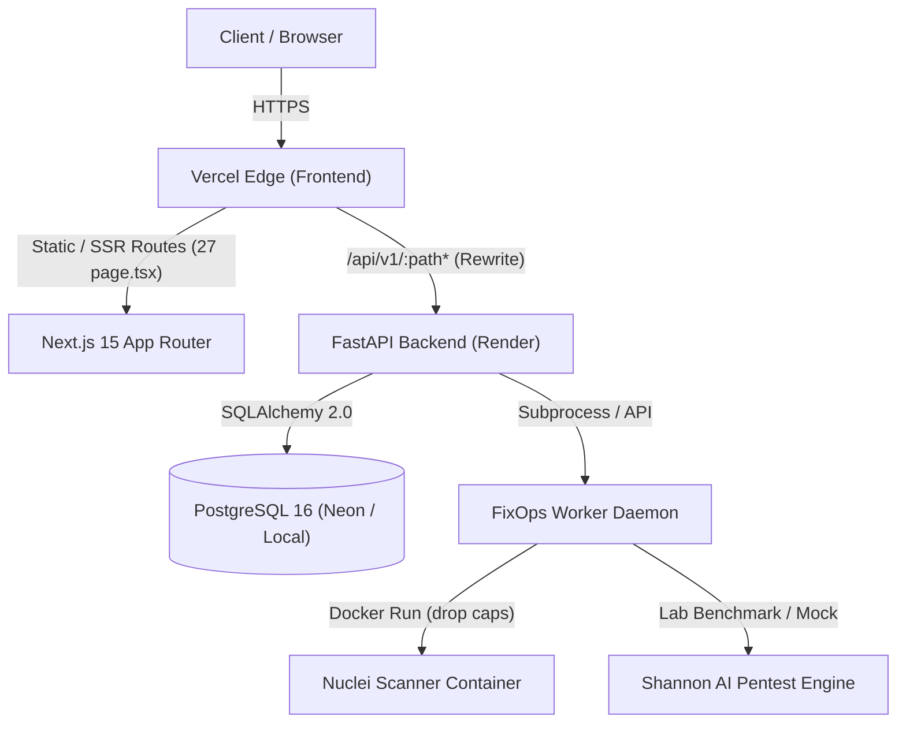
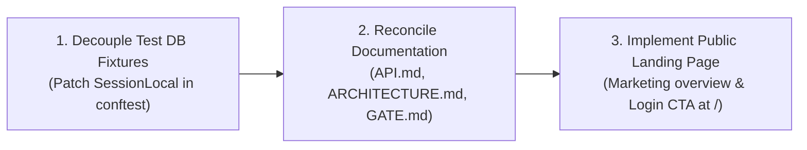

# Lazy Nerds Website & FixOps Platform — Evidence-Based Baseline Audit (LNA-15)

**Date**: October 25, 2026
**Auditor**: Coder (`coder-mvnfg3i9`)
**Scope**: Workspace `/Users/loki/Desktop/LAZY NERD`, Git `main` branch, and live production deployment at `https://lazynerds.vercel.app`.
**Mode**: Strict Read-Only Audit (zero modifications to code, data, migrations, secrets, or deployment).

---

## Executive Summary

This audit establishes an empirical, evidence-based baseline of the Lazy Nerds platform following the completion and acceptance of task **LNA-14**. Every finding below is substantiated by direct inspection of current source code, local test executions, and non-destructive live HTTP checks.



---

## 1. Actual System Architecture

### 1.1 Source Repository & Git Baseline
- **Current Branch**: `main`
- **Head Commit**: `c1f22de50e9b466782498c7d26b05a1ef72d6178` (`fix(ui): prevent brand and control overlap in mobile topbar at 320px (LNA-14)`)
- **Remote Synchronization**: Fast-forward push completed; `main` is identical to `origin/main`. Working tree clean.

### 1.2 Frontend Architecture
- **Framework**: Next.js `15.5.28` (App Router), React `19.0.0`, TypeScript `5.7.3`, Tailwind CSS `3.4.17`.
- **UI Design System**: Liquid Glass / Obsidian Cockpit theme (`#090A0D` bedrock background, hairline `.specular-top` highlights, Lucide React icons, and exactly **one** prominent `#F5C518` primary action per screen).
- **Route Inventory**: 27 App Router `page.tsx` routes across public auth, legal (`/privacy`, `/terms`), root auth redirect (`/`), and operational workspaces (no marketing landing route existed at baseline).
- **Architectural Discovery**: The root route `/` (`frontend/app/page.tsx`) is an authentication redirect router, **not** a public marketing landing page. It immediately redirects authenticated users to `/overview` and unauthenticated visitors to `/login`. The only public pages are `/privacy` and `/terms`.

### 1.3 Backend Architecture
- **Framework**: FastAPI (Python `3.12.15`), Pydantic v2, SQLAlchemy `2.0` ORM, Psycopg `3`.
- **API Surface**: Versioned `/api/v1` with 13 modular routers registered in `backend/app/api/v1/api.py`:
  - `health`, `auth`, `registrations`, `clients`, `engagements`, `assets`, `findings`, `workers`, `automation`, `reports`, `notifications`, `audit-logs`, `overview`.
- **Database Engine**: PostgreSQL 16 (Neon Lakebase Postgres in cloud staging/production; local Docker container `fixops-postgres` on port 5432; SQLite configured for test runs via `backend/tests/conftest.py`, though not safely isolated across working directories).
- **Database Migrations**: 5 tracked Alembic revisions in `backend/migrations/versions/`:
  - `001_initial_schema.py`
  - `002_add_engagements_table.py`
  - `003_complete_fixops_platform.py`
  - `004_roles_registrations_auth.py`
  - `005_worker_ownership_leases.py`

### 1.4 Worker & Scanner Subsystem
- **Daemon**: `worker/fixops_worker.py` (standalone daemon executing Nuclei and Shannon security tools).
- **Sandbox Isolation**: Resource-constrained Docker execution (`--cpus 1.0`, `--memory 2g`, `--cap-drop ALL`, `--security-opt no-new-privileges:true`).
- **Lifecycle & Claim Protection**: Lease-based claims (`WORKER_LEASE_SECONDS`), atomic row locks (`with_for_update`), claimant HTTP 403 authorization guards, and automatic abandoned-worker recovery.

---

## 2. Feature Inventory & Verification Tiers

Each platform area is categorized under one of five verified tiers:
1. **Production-verified**: Verified operational against live production endpoints (`https://lazynerds.vercel.app`).
2. **Integrated**: Verified locally across multiple interacting services (frontend, backend, database, worker, or Docker).
3. **Tested locally**: Validated by passing unit or focused regression test suites in this workspace.
4. **Implemented untested**: Present in code or configuration, but lacking comprehensive tests or active consumers.
5. **Not implemented**: Completely absent in the codebase despite historical documentation.

| Area / Feature | Implemented In | Verification Tier | Evidence & Notes |
|---|---|---|---|
| **SaaS Root Gateway (`/`)** | `frontend/app/page.tsx` | **Production-verified (Auth Redirect)** | HTTP 200; client redirect evaluates `useAuth()` to `/overview` or `/login`. No public marketing brochure existed at baseline. |
| **Public Marketing Homepage** | *None* | **Not implemented (at baseline)** | No marketing brochure, pricing table, or hero section existed at `/` during baseline audit. |
| **Public Legal Pages** | `app/privacy`, `app/terms` | **Production-verified** | HTTP 200; prerendered; contains company counsel placeholders `[COMPANY LEGAL ENTITY]`. |
| **User Authentication & JWT** | `app/login`, `api/v1/auth` | **Production-verified** | HTTP 200; bcrypt passwords, HttpOnly session cookie, 401 on invalid credentials. |
| **Password Reset Recovery** | `app/forgot-password`, `services/password_reset_service.py` | **Integrated** | Tested via `test_password_reset.py` (6/6 passed); HTML email generation via mock/resend. |
| **Self-Service Registration** | `app/register`, `services/registration_service.py` | **Integrated** | Tested via `test_roles_and_registration.py` (5/5 passed); founder approval queue. |
| **Role-Based Access Control** | `api/deps.py`, route guards | **Tested locally** | 3 distinct roles (`founder`, `employee`, `client`); client tenant isolation strictly enforced. |
| **Client Management Directory** | `app/clients`, `api/v1/clients.py` | **Integrated** | Tested via `test_clients.py` (14/14 passed); server pagination, search, sorting, soft archival. |
| **Client Onboarding Wizard** | `app/clients/new/page.tsx` | **Integrated** | Tested via `wizard-and-navigation.test.mjs` (4-step validated wizard). |
| **Security Engagements Scoping** | `app/engagements`, `api/v1/engagements.py` | **Integrated** | Tested via `test_engagements.py` (17/17 passed); RoE verification (`draft`, `pending`, `confirmed`). |
| **Terminal Engagement Lock** | `api/v1/engagements.py` | **Tested locally** | Completed/cancelled engagements immutable; row-level lock serialization on ingestion. |
| **Target Asset Scoping** | `app/assets`, `api/v1/assets.py` | **Tested locally** | Validated asset association with client and engagement scope. |
| **Multi-Layer SSRF Defense** | `core/security.py` | **Tested locally** | Tested via `test_security.py` (21/21 passed); blocks cloud metadata, private IPs, sensitive ports. |
| **Fail-Closed Lab Pentest** | `services/scanner_service.py` | **Tested locally** | Enforces lab target rejection in production even when `ALLOW_LAB_TESTING=true`. |
| **Website Audit Launcher** | `app/audit`, `api/v1/engagements.py` | **Integrated** | Tested via `test_website_audit.py` (13/13 passed); access checks precede DNS resolution. |
| **Source-Assisted Pentest** | `services/scanner_service.py` | **Unavailable (Path validation only)** | Validates local directory existence and rejects remote Git URLs; operational AI source-assisted pentesting is currently unavailable. |
| **Nuclei Container Execution** | `worker/fixops_worker.py` | **Integrated** | Verified with Docker daemon running `projectdiscovery/nuclei:latest`. |
| **Worker Lease & Recovery** | `api/v1/workers.py` | **Tested locally** | Tested via `test_worker_api.py` (14/14 passed); claimant 403 fences and abandoned job sweep. |
| **Findings Management** | `app/findings`, `api/v1/findings.py` | **Integrated** | Tested via `findings-ui.test.mjs`; 0 sticky table occlusion; 5 status transitions. |
| **Remediation Automations** | `app/automation`, `services/automation_engine.py` | **Tested locally** | Tested via `test_remediation_automation.py` (4/4 passed); SLA tracking and webhook dispatch. |
| **Executive Reports** | `app/reports`, `services/report_service.py` | **Tested locally** | Generates executive markdown and JSON metrics breakdown. |
| **Object Storage (S3 / Neon)** | `core/config.py` | **Implemented untested** | S3 credentials wired into settings; no active endpoint currently uploads blobs to S3. |
| **Shannon AI Model Resolver** | `core/ai_provider.py` | **Tested locally** | Tested via `test_ai_provider_config.py` (7/7 passed); preflight fast-fails without paid credits. |
| **Settings Reorganization** | `app/settings/page.tsx` | **Production-verified** | HTTP 200; responsive master-detail layout; dynamic health telemetry; accurate schema badge. |
| **320px Topbar Header** | `components/layout/topbar.tsx` | **Production-verified** | Zero collision; >30px separation between brand wordmark and notification controls at 320px. |
| **Custom Domain (`lazynerds.com`)** | *Infrastructure* | **Not implemented** | Active domain is `lazynerds.vercel.app`; custom DNS records not connected. |
| **ESLint Frontend Suite** | `frontend/package.json` | **Implemented untested** | `next lint` missing `.eslintrc.json`; prompts interactively. |

---

## 3. Relevant Paths & Verification Commands

### 3.1 Verification Commands
- **Frontend Test Suite (99 tests)**:
  ```bash
  npm --prefix frontend test
  ```
- **Frontend TypeScript Compilation (0 errors)**:
  ```bash
  cd frontend && npx tsc --noEmit
  ```
- **Frontend Visual Inspection (23 routes, 5 viewports)**:
  ```bash
  node frontend/tests/verify-settings-responsive.mjs
  node frontend/tests/visual-inspection-capture.mjs
  ```
- **Backend Test Suite (163 collected tests: 162 passed, 1 skipped)**:
  ```bash
  PYTHONPATH=backend backend/.venv/bin/pytest backend/tests -k "not integration and not live" -q
  ```
- **Production Health & Endpoint Verification**:
  ```bash
  curl -s https://lazynerds.vercel.app/api/v1/health
  curl -s -o /dev/null -w "%{http_code}\n" https://lazynerds.vercel.app/settings
  curl -s -o /dev/null -w "%{http_code}\n" https://lazynerds.vercel.app/api/v1/clients
  ```

---

## 4. Exact Test Results

### 4.1 Frontend Suite
- **Total Tests**: 99
- **Suites**: 7
- **Passed**: 99
- **Failed**: 0
- **Duration**: `~310ms`
- **TypeScript**: `tsc --noEmit` exited with code `0` (clean).

### 4.2 Backend Suite (18 test files, 163 collected tests: 162 passed, 1 skipped)
| Test Module | Total Tests | Status | Execution Time |
|---|---|---|---|
| `test_ai_provider_config.py` | 7 | **7 passed** | 0.05s |
| `test_auth.py` | 10 | **10 passed** | 3.17s |
| `test_bugfixes_lna4.py` | 13 | **13 passed** | 3.54s |
| `test_clients.py` | 14 | **14 passed** | 3.29s |
| `test_e2e_engagements_flow.py` | 1 | **1 passed** | 0.84s |
| `test_e2e_full_flow.py` | 2 | **2 passed** | 0.77s |
| `test_e2e_shannon_fixops_flow.py` | 1 | **1 passed** | 0.08s |
| `test_engagements.py` | 17 | **17 passed** | 4.00s |
| `test_migration.py` | 2 | **2 passed** | 0.25s |
| `test_password_reset.py` | 6 | **6 passed** | 2.28s |
| `test_platform_modules.py` | 6 | **6 passed** | 1.85s |
| `test_remediation_automation.py` | 4 | **4 passed** | 1.03s |
| `test_roles_and_registration.py` | 5 | **5 passed** | 1.98s |
| `test_scanner_service.py` | 21 | **20 passed, 1 skipped** (1 live container skipped) | 102.22s |
| `test_security.py` | 21 | **21 passed** | 2.01s |
| `test_validation.py` | 6 | **6 passed** | 1.64s |
| `test_website_audit.py` | 13 | **13 passed** | 4.09s |
| `test_worker_api.py` | 14 | **14 passed** | 3.17s |

*Total Backend Run*: **162 passed, 1 skipped** (offline test execution from repository root with `PYTHONPATH=backend`).

### 4.3 Coder-Reported Production Checks (Subject to Independent Operator Review)
- `GET https://lazynerds.vercel.app/` -> `HTTP/2 200 OK` (client auth redirect to `/overview` or `/login`)
- `GET https://lazynerds.vercel.app/settings` -> `HTTP/2 200 OK` (etag: `"93cfca4b330f542ffe28011c3b4e7440"`, prerender cache active)
- `GET https://lazynerds.vercel.app/api/v1/health` -> `HTTP/2 200 OK`
  ```json
  {
    "status": "ok",
    "service": "Lazy Nerds FixOps Client Manager",
    "version": "1.0.0",
    "commit": "f59f368101d4b505ca8a854fdcf609ef45e20dba",
    "environment": "production",
    "worker_dispatch_mode": "auto",
    "database": "connected"
  }
  ```
- `GET https://lazynerds.vercel.app/api/v1/clients` -> `HTTP/2 401 Unauthorized` (strict auth enforcement).

---

## 5. Confirmed Limitations & Technical Debt

1. **No Public Marketing Presence**:
   The website currently lacks a public-facing brochureware homepage. Visiting `https://lazynerds.vercel.app` drops visitors into an application loader and redirects to `/login`.
2. **Backend Test DB Coupling in `conftest.py`**:
   `app.main` runs `init_db_and_seed_admin()` during FastAPI startup lifespan, which uses `SessionLocal` bound to `app.db.session.engine`. If PostgreSQL is not listening on port 5432 and pytest is run without overriding `SessionLocal`, every test using `client` encounters a connection failure before test logic runs.
3. **Working Directory Path Sensitivity**:
   Tests invoking `scanner_service.launch_scan` with `source_repo="lab/vulnerable_app"` expect the current working directory to be the repository root (`/Users/loki/Desktop/LAZY NERD`). Running pytest from inside `backend/` causes `os.path.isdir("lab/vulnerable_app")` to fail.
4. **Offline Scanner Gating**:
   Full scanner execution in `test_scanner_service.py` spawns real Docker containers running `projectdiscovery/nuclei:latest` with network timeouts exceeding 60 seconds per test. Offline or CI test runners should deselect live container runs.
5. **Documentation Divergence**:
   - `docs/ARCHITECTURE.md` still describes core modules (`engagements`, `findings`, `assets`, `remediation`) as "Planned Future Entities" despite full implementation.
   - `docs/API.md` documents only 3 of 13 active routers.
   - `docs/PRE_LAUNCH_GATE.md` cites stale test counts (146 backend / 71 frontend).
6. **Frontend Lint Tooling**:
   `npm --prefix frontend run lint` does not run cleanly in automated CI because `.eslintrc.json` is missing.

---

## 6. Three Prioritized Next Tasks



### Task 1: Decouple Backend Test Runner from Host PostgreSQL & Make Test SQLite Safely Isolated
- **Priority**: High (Engineering Velocity & CI Reliability)
- **Objective**: In `backend/tests/conftest.py`, replace the fixed relative `sqlite:///./test_fixops.db` path with an isolated temporary SQLite database per test run, ensuring FastAPI lifespan `engine`/`SessionLocal` and dependency overrides consistently use the test engine without risking local working directory files. Ensure tests pass cleanly and safely from both repo root and `backend/`.

### Task 2: Reconcile Stale Platform Documentation (`API.md`, `ARCHITECTURE.md`, `PRE_LAUNCH_GATE.md`)
- **Priority**: High (Governance & Accuracy)
- **Objective**: Bring platform documentation in line with current source code. Document all 13 API routers in `API.md`, update entity relationships and data models in `ARCHITECTURE.md`, and update test tallies (163 backend tests, 99 frontend tests) in `PRE_LAUNCH_GATE.md`.

### Task 3: Design & Implement a Public Marketing Landing Page at `/`
- **Priority**: Medium (Commercial Readiness)
- **Objective**: Replace the raw client redirect at `/` with a public marketing presence for Lazy Nerds (brand identity, cybersecurity services, penetration testing methodology, client portal access CTA, and contact inquiry), routing authenticated users seamlessly to `/overview`.

---

## 7. Assessment of Current Documentation & Ledger

- **Authority**: `hive/tasks.json` serves as the authoritative, functioning task ledger and requires **no duplicate tracker**.
- **Documentation Adequacy**: Current documents (`docs/API.md`, `docs/ARCHITECTURE.md`, `docs/PRE_LAUNCH_GATE.md`) provide a solid structural framework but have drifted as new modules were added. They do not require a rewrite, but rather a focused synchronization (addressed in Task 2 above).
