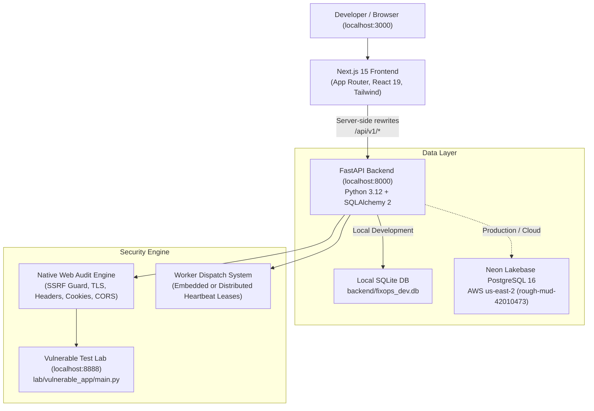

# Lazy Nerds FixOps — Workstation Development & Operations Manual

**Last Updated**: October 27, 2026  
**Target Environment**: macOS Darwin 25.x (Apple Silicon `arm64`)  
**Workspace Directory**: `/Users/loki/Projects/LazyNerds`  
**Git Remote**: `https://github.com/lokeshnalabothula/LazyNerds.git`  
**Active Branch**: `main`  
**Baseline Commit**: `cb36da8` (`cb36da8365c8a5c04f064245cefa04a5f659fbdb`)

---

## 1. System Architecture & Component Map

FixOps is a security operations and vulnerability management platform built with modern full-stack web and systems technologies.



### Component Directory Map

| Path | Role / Description |
|---|---|
| `frontend/app/` | Next.js 15 App Router pages (`/`, `/overview`, `/clients`, `/engagements`, `/audit`, `/findings`, `/automation`, `/reports`, `/settings`) |
| `frontend/components/` | Reusable UI components styled with Google Stitch Liquid Glass & Obsidian dark tokens |
| `frontend/lib/` | Core frontend utilities: `api.ts` (API client), `finding-interpreter.ts` (plain-English security advice), `validators.ts` (Zod schemas) |
| `frontend/tests/` | 9 test suites (112 unit tests) executed via Node.js native test runner |
| `backend/app/api/v1/` | 13 FastAPI REST API routers (auth, clients, engagements, assets, findings, workers, audit, etc.) |
| `backend/app/models/` | Declarative SQLAlchemy 2 models with strict UTC timestamps and tenant isolation |
| `backend/app/services/` | Business logic, scanner orchestration (`scanner_service.py`), and native security auditor (`web_audit_engine.py`) |
| `backend/migrations/` | 5 Alembic database migrations up to `005_worker_ownership_leases` |
| `backend/tests/` | 164 pytest tests (unit, integration, migrations, and E2E flows) |
| `lab/vulnerable_app/` | Isolated local target on port 8888 for safe, non-destructive scanner validation |
| `scripts/dev.sh` | Unified developer control CLI script |
| `.agents/skills/` | Agent skills including Neon SDK integration guides |

---

## 2. Toolchain & Runtime Environment

The workstation environment is fully configured in user space without requiring root privileges:

| Tool | Version | Executable Path | Purpose |
|---|---|---|---|
| **Git** | `2.50.1` | `/usr/bin/git` | Version control |
| **Node.js** | `v22.14.0` (LTS) | `~/.local/opt/node/bin/node` | Frontend runtime |
| **pnpm** | `9.15.4` | `~/.local/bin/pnpm` | Package manager (workspace pinned) |
| **Python** | `3.12.16` | `~/.local/bin/python3.12` | Backend language |
| **Astral uv** | `0.13.6` | `~/.local/bin/uv` | Fast Python package & version manager |
| **Backend Venv** | Python 3.12 | `backend/.venv/` | Isolated backend dependency sandbox |

### Persistent Shell Variables
Configured in `~/.zshrc` and `~/.zshenv`:
```bash
export PATH="$HOME/.local/bin:$PATH"
export NODE_OPTIONS="--experimental-strip-types"
```

---

## 3. Daily Development Workflow

Use the unified control script `./scripts/dev.sh` from the repository root:

### Running Services
```bash
# Start FastAPI backend (port 8000)
./scripts/dev.sh backend

# Start Next.js frontend (port 3000)
./scripts/dev.sh frontend

# Start local vulnerable test lab (port 8888, optional for scanning tests)
./scripts/dev.sh lab

# Check status of running FixOps processes
./scripts/dev.sh status

# Inspect health endpoints of running services
./scripts/dev.sh health

# Stop all local FixOps processes
./scripts/dev.sh stop-all
```

### Running Tests & Quality Verification
```bash
# Run all unit tests (112 frontend + 163 backend)
./scripts/dev.sh test

# Run frontend tests only
./scripts/dev.sh test-frontend

# Run backend pytest suite only
./scripts/dev.sh test-backend

# Run frontend ESLint
./scripts/dev.sh lint

# Run frontend TypeScript type checking
./scripts/dev.sh typecheck

# Run Next.js production build
./scripts/dev.sh build

# Complete pre-push verification pipeline
./scripts/dev.sh check-all
```

### Database Operations
```bash
# Apply pending Alembic migrations
./scripts/dev.sh db-migrate

# Check current migration revision
./scripts/dev.sh db-status

# Test migration upgrade and downgrade idempotency
./scripts/dev.sh db-check
```

---

## 4. Environment Variables & Security Safeguards

### Local Environment Files
- Project Root: `.env` (contains development database, secret key, and port settings)
- Backend: `backend/.env` (symlinked to `../.env`)
- Frontend: `frontend/.env.local` (`INTERNAL_API_URL=http://127.0.0.1:8000`)

### Security Rules
1. **Never commit `.env` or `.env.local`**: Both are explicitly excluded in `.gitignore`.
2. **Fail-Closed Scanner Protection**: In production (`ENVIRONMENT=production`), lab testing is strictly blocked regardless of the `ALLOW_LAB_TESTING` flag.
3. **SSRF Guard**: The scanner engine strictly enforces private RFC 1918 IP blocks, metadata endpoint protection, and scheme whitelisting.

---

## 5. External Account Integrations & Status

| Service | Role | Auth Status | Configuration Required for Full Sync |
|---|---|---|---|
| **GitHub** | Code repository & CI | Read-only (HTTPS) | To push to `origin/main`, configure GitHub Personal Access Token or SSH key. |
| **Neon PostgreSQL** | Cloud Database (`rough-mud-42010473`) | Local SQLite in dev | To connect locally to Neon, set `DATABASE_URL` in `.env` with your Neon connection string. |
| **Vercel** | Frontend Hosting (`lazynerds.vercel.app`) | Auto-deploys via GitHub | Managed via GitHub `main` branch pushes. |
| **Render** | Backend Hosting (`lazynerds-backend.onrender.com`) | Auto-deploys via GitHub | Managed via GitHub `main` branch pushes. |

---

## 6. Controlled Git & Deployment Workflow

### Making Changes
1. Create a feature branch or work directly on `main` for verified tasks:
   ```bash
   git status
   git diff
   ```
2. Verify all checks pass before staging:
   ```bash
   ./scripts/dev.sh check-all
   ```
3. Stage and commit meaningful, well-tested units:
   ```bash
   git add <modified-files>
   git commit -m "type(scope): concise description of verified change"
   ```
4. Push to GitHub when ready:
   ```bash
   git push origin main
   ```
   *(Automatic CI checks run via GitHub Actions, and production deployments on Vercel and Render are triggered automatically).*
